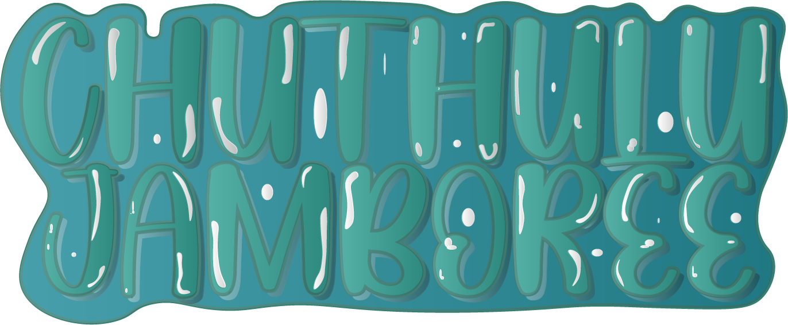
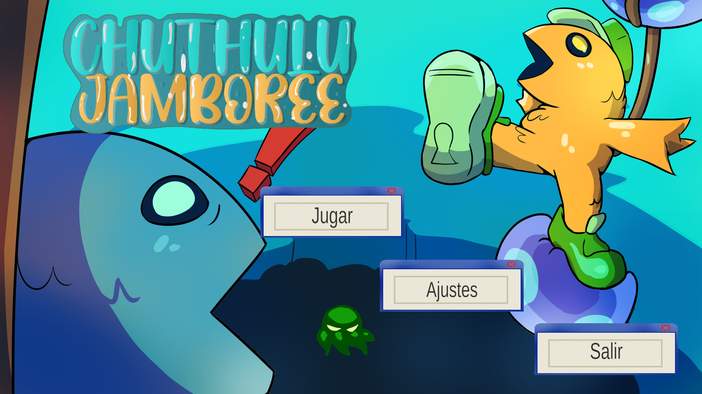
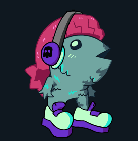
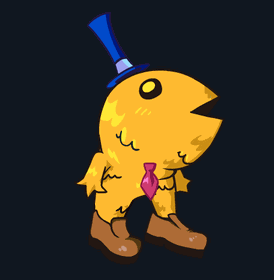
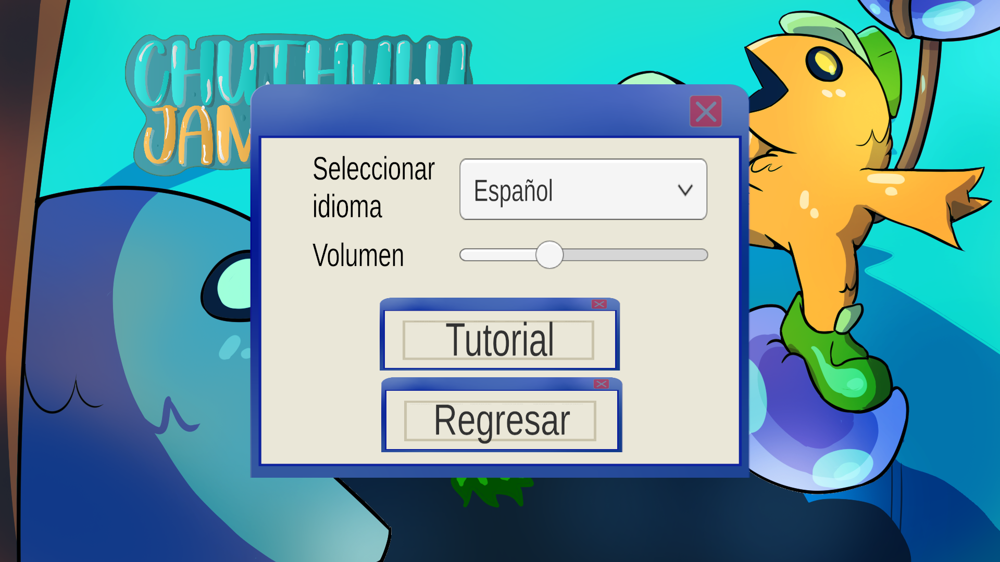
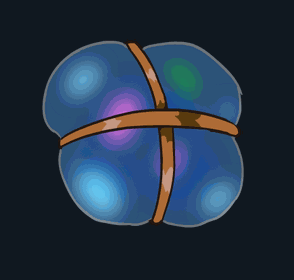
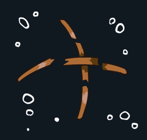
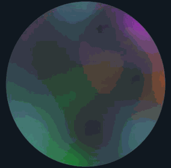
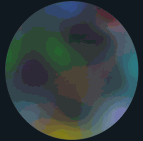
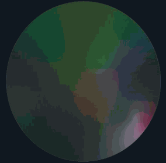

<p align="center">
  
</p>

<h1 align="center">Cthulhu Jamboree</h1>

<p align="center">
  <em>Combate 1v1 de burbujas. Sé el último en caer al vacío.</em>
</p>

<p align="center">
  
  
  
  
  
</p>

<p align="center">
  <a href="https://crimpatches.itch.io/chutulu-jamboree">
    
  </a>
</p>

---

## Índice

- [Qué es](#qué-es)
- [Cómo se juega](#cómo-se-juega)
- [Controles](#controles)
- [Mecánicas](#mecánicas)
  - [El globo y la caída](#el-globo-y-la-caída)
  - [Las burbujas](#las-burbujas)
  - [Gravedad progresiva](#gravedad-progresiva)
  - [Objetos del escenario](#objetos-del-escenario)
- [Personajes](#personajes)
- [Idiomas](#idiomas)
- [Arte y animación](#arte-y-animación)
- [Audio](#audio)
- [Estructura del proyecto](#estructura-del-proyecto)
- [Cómo ejecutarlo](#cómo-ejecutarlo)
- [El proceso de la jam](#el-proceso-de-la-jam)
- [Equipo](#equipo)

---

## Qué es

Cthulhu Jamboree es un juego de combate local 1v1 para dos jugadores, hecho en la Global Game Jam 2025. Cada jugador controla un pez: uno cool y otro uncool.

La premisa sale de la mitología que da nombre al juego. La sociedad pez adoraba a Cthulhu con sacrificios hasta que descubrió que al dios le gustaba su comida tradicional, y desde entonces decide los sacrificios con duelos de burbujas. En esta partida, los campeones elegidos son tú y tu mejor amigo.

El juego está hecho con Unity 2022.3.56f1 y se publicó para HTML5 en itch.io.

<p align="center">
  <a href="https://crimpatches.itch.io/chutulu-jamboree">
    
  </a><br>
  <sub>El menú principal: los dos peces se enfrentan y el Cthulhu verde los observa desde el centro.</sub>
</p>

---

## Cómo se juega

Cada jugador empieza colgando de un globo que lo mantiene a flote. El objetivo es reventar el globo del rival: cuando eso pasa, su dueño cae al vacío y pierde.

Para lograrlo, los jugadores rebotan entre sí y contra las burbujas que suben desde abajo. Cada choque revienta una burbuja, y el peligro es que el globo del rival aguante más que el tuyo.

Gana el último que quede en pie. La partida se resuelve en pocos segundos, así que es un duelo rápido y caótico pensado para jugarse en el mismo teclado.

---

## Controles

| Jugador | Moverse izquierda | Moverse derecha |
| --- | --- | --- |
| Persona A | `A` | `D` |
| Persona B | `←` | `→` |

Los dos jugadores comparten el mismo teclado. El panel de pausa se abre con el botón de pausa en pantalla.

---

## Mecánicas

### El globo y la caída

Cada jugador cuelga de un globo, y ese globo es su vida: mientras siga intacto, flota. Cuando revienta, `PlayerController.DropFaster()` sube la masa y la gravedad del jugador para que caiga de inmediato.

La zona de muerte de la escena detecta cuándo alguien sale de pantalla y dispara el final de partida, que muestra quién ganó.

### Las burbujas

Las burbujas son el centro del combate. `Bubble.cs` les da dos comportamientos.

Al aparecer, cada burbuja se impulsa hacia arriba con una fuerza configurable, para que suba a la zona de juego. Al chocar con un jugador, calcula la dirección del impacto `(posición jugador − posición burbuja)`, la normaliza y aplica un impulso de rebote al `Rigidbody2D` del jugador. Eso sustituye la física de rebote de Unity por un empuje controlado, que resulta más predecible. Después reproduce la animación de explosión y se destruye sola, esperando la duración exacta del clip.

Las burbujas aparecen en oleadas: `BubbleSpawner.cs` genera grupos de 3 burbujas cada 4 segundos, con un retardo inicial de 8 segundos. Dentro de cada oleada salen con 0,1 s de separación y en una posición X aleatoria dentro de un rango amplio, para que el combate no sea repetitivo.

### Gravedad progresiva

`PlayerController.cs` lleva una cuenta atrás que complica la partida con el tiempo:

| Momento | Qué ocurre |
| --- | --- |
| Primeros 10 s | El jugador está congelado (`FreezeAll`, gravedad 0). Es la animación VS inicial. |
| Pasados 10 s | Se libera el movimiento, se permite giro y la gravedad sube a 0,5 |
| Pasados 30 s | La gravedad sube 0,1 cada 10 s hasta un máximo de 5 |
| Globo reventado | La gravedad salta a 5 y el jugador cae sin remedio |

Con esto ninguna partida se alarga para siempre: cuanto más dura el duelo, más cuesta mantenerse a flote.

### Objetos del escenario

Además de las burbujas, caen objetos desde arriba (conchas, rocas, anclas). `ObjetosSpawner.cs` funciona igual que el spawner de burbujas, pero los lanza por arriba, y también revientan burbujas al chocar. Es un tercer factor de caos que los jugadores pueden aprovechar o sufrir.

---

## Personajes

Dos peces, cada uno con su personalidad:

<p align="center">
  
  
</p>

| Personaje | Descripción |
| --- | --- |
| Cool Fish | El pez con gorra, auriculares y zapatillas. El popular del duelo. |
| Uncool Fish | El pez desgarbado, con la lengua fuera y cara de no entender nada. |
| Cthulhu | El dios verde que observa desde el centro del escenario. |

---

## Idiomas

El juego está en español e inglés, con un selector en el menú de configuración. El idioma elegido se guarda y se mantiene durante toda la partida, incluso al cambiar de escena.

Los textos viven en archivos JSON dentro de `Assets/StreamingAssets/` (`es-lang.json`, `en-lang.json`), y un `LanguageManager` los aplica en todas las escenas: menú, configuración, pausa y cinemática.

<p align="center">
  <br>
  <sub>El panel de configuración, con el selector de idioma y el control de volumen.</sub>
</p>

---

## Arte y animación

Todo el arte es 2D dibujado a mano durante la jam, con Paint Tool SAI, Clip Studio Paint y Adobe Illustrator. Los personajes se animan con secuencias de sprites (idle y caída), y las burbujas tienen animación de reposo y de explosión.

<p align="center">
  
  
</p>

El escenario son capas de parallax que se reposicionan al subir, para dar sensación de ascenso continuo.

<p align="center">
  
  
  
</p>

---

## Audio

El juego usa tres pistas de música, una por escena:

| Escena | Pista |
| --- | --- |
| Menú | `mmenu2` |
| Combate | `bgm` |
| Cinemática | `bgm_cinematic` |

Los efectos cubren la explosión de burbujas, el pop de los objetos, clics de interfaz, un aviso de peligro y la voz profunda de pelea. El volumen se ajusta desde el panel de configuración y se conserva entre escenas.

---

## Estructura del proyecto

```
GameJam2025/
├── PrototipoGameJam2025/          Proyecto de Unity
│   ├── Assets/
│   │   ├── Scenes/                EsambladoEsqueleto, Menu, Cinematics (+4 de prueba)
│   │   ├── Scrips/                Código en C# (24 scripts)
│   │   ├── Art/                   Sprites, animaciones y UI
│   │   ├── Audio/                 Música y efectos
│   │   ├── Prefabs/               Burbujas, conchas, rocas, fondo
│   │   ├── Jsons/                 Textos de idioma (fuente)
│   │   └── StreamingAssets/       Textos de idioma (los que lee el juego)
│   ├── Packages/                  Dependencias
│   └── ProjectSettings/           Configuración del proyecto
├── docs/img/                      Imágenes y GIFs que usa este README
├── screenshots/                   Capturas originales
└── tools/make_gifs.py             Genera los GIFs desde las hojas de sprites
```

Los scripts están agrupados por sistema: `Personaje` (movimiento, globo, animaciones), `Burbujas` (burbuja, spawner, limpiador), `Objetos` (spawner de objetos), `Escenario` (parallax, tiles), `AnimacionVs` (la intro VS), `lenguajes` (idiomas) y `UI` (cambio de escena, pausa, audio).

---

## Cómo ejecutarlo

En el navegador, desde itch.io:

[👉 Jugar Cthulhu Jamboree en itch.io](https://crimpatches.itch.io/chutulu-jamboree)

En el editor de Unity:

1. Instala Unity 2022.3.56f1 con el módulo de WebGL Build Support.
2. Abre la carpeta `PrototipoGameJam2025/` con Unity Hub.
3. Abre la escena `Assets/Scenes/Menu.unity`.
4. Pulsa Play.

Orden de escenas en el build: `EsambladoEsqueleto` → `Menu` → `Cinematics`.

---

## El proceso de la jam

El proyecto se hizo durante la Global Game Jam 2025, bajo el tema propuesto para esa edición. El arte está dibujado a mano y la cinemática narra el contexto de la mecánica de las burbujas.

La idea nace de un chiste: tomar la mitología de Cthulhu (sacrificios, dioses antiguos) y convertirla en una pelea absurda entre dos peces por quién no es sacrificado. De ahí salen los personajes, la cinemática y el nombre.

---

## Equipo

Proyecto de la Global Game Jam 2025, desarrollado por Crim.Patches:

| Integrante | Rol |
| --- | --- |
| Cristian Pacheco | Animador y artista 2D |
| Brayan León | Programador y ensamblaje |
| Stiven Rueda | Diseño de interfaces |
| Minuk Lee | Música y efectos |
| Esteban Ruíz | Programador y ensamblado |
| Ricardo Quintero | Ensamblado |

<br>

<p align="center">
  <sub>Global Game Jam 2025 · Unity 2022.3.56f1 · HTML5 · Crim.Patches</sub><br>
  <a href="https://crimpatches.itch.io/chutulu-jamboree">crimpatches.itch.io/chutulu-jamboree</a>
</p>
